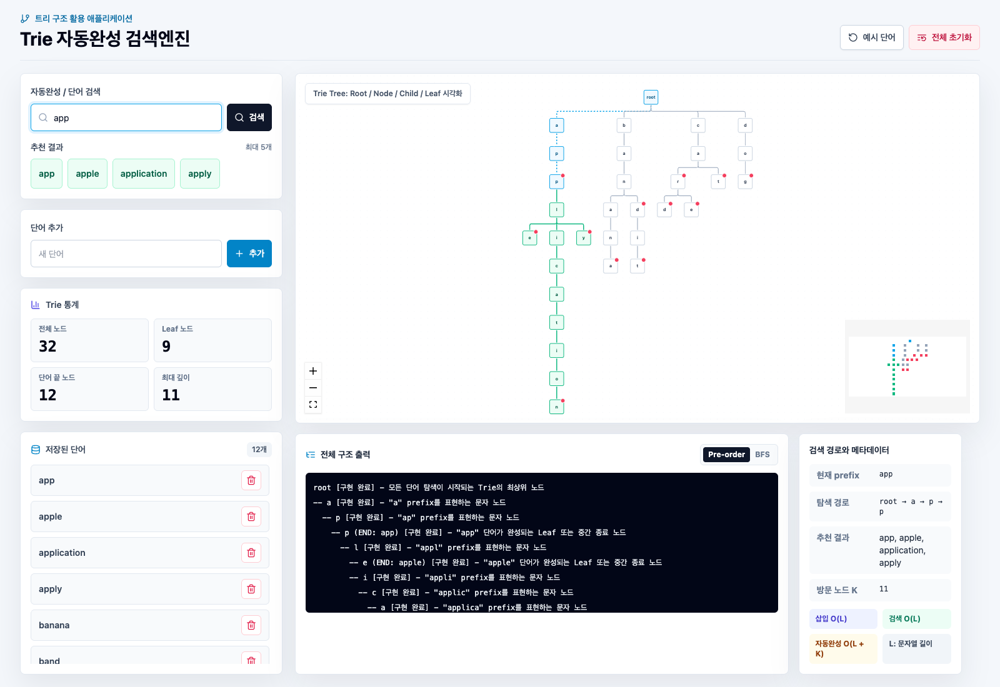

# Trie 자동완성 검색엔진

Trie(접두사 트리) 자료구조로 단어를 저장하고, 입력한 접두사로 시작하는 단어를 추천하는 웹앱입니다. 단어 추가·삭제·검색, 자동완성, 전체 구조 출력(Pre-order, BFS), 통계, 트리 시각화를 한 화면에서 볼 수 있습니다. 트리 구조를 활용한 애플리케이션을 만드는 사이드 프로젝트입니다.

> English summary: a small React web app that stores words in a Trie and shows prefix autocomplete. It also provides word search, add and delete, Pre-order and BFS dumps, tree statistics, and a React Flow visualization of the trie. The trie is implemented from scratch in `src/trie.js`. Words are kept in the browser's localStorage.



## 기능

- **자동완성:** 입력한 접두사로 시작하는 단어를 최대 5개 추천합니다. 추천 단어를 누르면 검색창에 채워집니다.
- **단어 검색:** 단어가 있는지 확인하고, 루트에서 그 단어까지의 경로와 노드 정보를 보여줍니다.
- **단어 추가·삭제:** 입력한 단어를 추가하고, 저장된 단어 목록에서 삭제합니다. 같은 단어는 중복해서 넣지 않습니다.
- **전체 구조 출력:** 트리를 Pre-order 또는 BFS 순서로 들여쓰기 형태의 텍스트로 출력합니다.
- **통계:** 전체 노드 수, Leaf 노드 수, 단어 끝 노드 수, 최대 깊이를 보여줍니다.
- **시각화:** React Flow로 트리를 그립니다. 검색 경로, 추천 단어의 경로, 방문한 노드, 단어 끝 노드를 색으로 구분합니다.
- **저장:** 단어 목록을 브라우저 localStorage(`trie-autocomplete-words`)에 저장합니다. 저장된 값이 없으면 기본 예시 단어 12개(`apple`, `app`, `application`, `apply`, `banana`, `band`, `bandit`, `cat`, `car`, `card`, `care`, `dog`)로 시작합니다.

단어는 앞뒤 공백을 지우고 소문자로 바꿔서 저장합니다. 문자열을 문자 단위로 나누므로 한글도 한 글자가 노드 하나입니다.

## 기술 스택

- React 18, Vite 5
- Tailwind CSS 3
- React Flow(`reactflow` 11)
- lucide-react(아이콘)

## 실행 방법

Node.js와 npm이 필요합니다.

```bash
npm install
npm run dev
```

Vite가 출력하는 주소를 브라우저로 엽니다. 기본 주소는 `http://localhost:5173`입니다. `npm run dev`는 `--host 0.0.0.0`으로 실행하므로 같은 네트워크의 다른 기기에서도 접속할 수 있습니다.

```bash
npm run build     # dist/ 에 정적 파일 생성
npm run preview   # 빌드 결과 확인
```

## 구현

Trie 로직은 `src/trie.js`에 있고 UI와 분리되어 있습니다. React 상태에는 단어 배열만 두고, 단어가 바뀔 때마다 `new Trie(words)`로 트리를 다시 만듭니다.

### 노드

`TrieNode`는 문자 하나를 나타냅니다. 필드는 다음과 같습니다.

| 필드 | 뜻 |
|---|---|
| `char`, `path` | 이 노드의 문자와 루트부터의 접두사 문자열 |
| `children` | 자식 노드 배열. 자식 수에 제한이 없는 N-ary 트리입니다. |
| `isEndOfWord`, `word` | 단어가 여기서 끝나는지와 그 단어 |
| `name`, `description`, `owner`, `status` | 화면에 보여주는 노드 메타데이터 |

### 알고리즘

`L`은 입력 문자열 길이, `K`는 자동완성이 방문한 노드 수입니다. 자식을 배열에서 찾기 때문에 노드마다 자식 수만큼 비교가 더 듭니다.

| 메서드 | 동작 | 복잡도 |
|---|---|---|
| `insert(word)` | 문자를 따라가며 없는 노드를 만들고 마지막 노드에 단어 끝을 표시합니다. 이미 있는 단어는 넣지 않습니다. | `O(L)` |
| `search(word)` | 문자 경로를 따라간 뒤 마지막 노드가 단어 끝인지 확인합니다. | `O(L)` |
| `searchWithMetadata(word)` | 존재 여부와 함께 탐색 경로, 노드 메타데이터를 돌려줍니다. | `O(L)` |
| `startsWith(prefix)` | 접두사 경로가 있는지만 확인합니다. | `O(L)` |
| `autocomplete(prefix, limit)` | 접두사 노드까지 이동한 뒤 DFS로 단어를 모읍니다. 자식은 문자 순서(`ko` 로케일)로 방문하고 `limit`개를 채우면 멈춥니다. | `O(L + K)` |
| `delete(word)` | 단어 끝 표시를 지우고, 다른 단어가 쓰지 않는 말단 노드만 위로 올라가며 제거합니다. | `O(L)` |
| `preOrderTraversal()` | 현재 노드를 먼저 출력하고 자식을 재귀로 방문합니다. | `O(N)` |
| `bfsTraversal()` | 큐로 깊이가 낮은 노드부터 방문합니다. | `O(N)` |
| `getStats()` | 전체 노드, Leaf, 단어 끝 노드, 최대 깊이를 셉니다. | `O(N)` |

`N`은 트리의 전체 노드 수입니다. 추천 순서는 빈도나 점수가 아니라 문자 순서입니다.

기본 예시 단어로 만든 트리는 전체 노드 32개, Leaf 9개, 단어 끝 12개, 최대 깊이 11입니다.

## 폴더 구조

```text
src/
  trie.js          TrieNode, Trie 클래스와 시각화 데이터 생성
  App.jsx          UI, localStorage 저장, React Flow 연결
  main.jsx         React 진입점
  styles.css       Tailwind 지시문과 전역 스타일
index.html         Vite 진입 HTML
report/            과제 보고서(HTML, PDF)와 화면 캡처
```

## 알려진 한계

- 화면의 삭제 버튼은 `Trie.delete()`를 호출하지 않고, 단어 배열에서 뺀 뒤 트리를 다시 만듭니다. `delete()`는 `src/trie.js`에만 구현되어 있습니다.
- 단어 수가 많아지면 트리를 매번 다시 만들고 전체를 다시 그리므로 느려질 수 있습니다. 큰 단어 집합으로는 측정하지 않았습니다.
- 자동 테스트는 없습니다.

## 라이선스

[MIT License](LICENSE)를 따릅니다.
